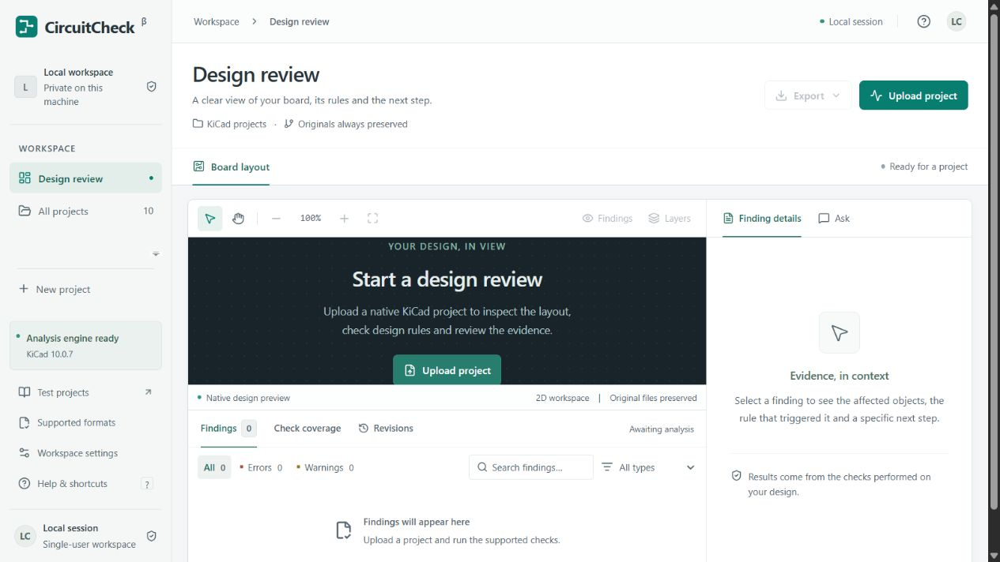

# CircuitCheck

Review a KiCad PCB project before sending it for fabrication. CircuitCheck runs native KiCad checks, shows each reported problem on the board, and lets you preview a supported correction in a separate copy before applying it and checking again.



## What it does

- Accepts a complete KiCad project ZIP or multiple native project files.
- Shows actual engine findings, reported locations, rule evidence and check coverage.
- Previews a correction for a supported straight-track width violation, then reruns native checks before apply is available.
- Preserves originals and revision history, with comparison, restore and native project export.
- Includes downloadable synthetic test projects with known expected results at `/test-files/`.
- Works without an AI key. Optional model explanations are separate from the native check results.

This is a local, single-user application. The workspace focuses on PCB review; accompanying schematics can still supply backend ERC and parity checks. The included Fieldnode design is an original synthetic test fixture, not a validated functional circuit.

## Tech stack

| Layer | Technology |
|---|---|
| Interface | React, TypeScript, Vite, Tailwind CSS |
| API | Python, FastAPI, Uvicorn |
| Analysis | Separate Python worker calling native KiCad CLI |
| Local storage | SQLite and project files |
| Tests | pytest and Playwright |

## Quick start

Clone or download this repository, open a terminal in its root, then follow the setup below. KiCad is installed separately; it is not bundled in the repository.

### Install and run

Tested host: Windows x64, Python **3.14.6**, Node **24.21.0**, npm **11.19.0**, KiCad **10.0.7**. Direct Python dependencies are pinned in `requirements.txt`; the tested full dependency set is in `requirements.lock.txt`. Frontend dependencies are pinned in `package.json` and `package-lock.json`.

1. Install Python 3.12 or later and Node 22.12 or later. Only the versions above were executed on this host.
2. Install **KiCad 10.0.7** from [the official Windows download page](https://www.kicad.org/download/windows/) or [official Linux instructions](https://www.kicad.org/download/linux/). Website visitors use the server's engine; they do not need KiCad on their own devices.
3. In this folder, run:

```powershell
.\scripts\setup.ps1
```

4. If KiCad is not found automatically, copy `.env.example` to `.env` and set its literal `KICAD_CLI` path. Leave `AI_API_KEY` empty for deterministic explanations.
5. Run `.\scripts\start.ps1`.

For Linux/macOS:

```sh
sh scripts/setup.sh
# If needed: export KICAD_CLI=/absolute/path/to/kicad-cli
.venv/bin/python scripts/start.py --open
```

Linux/macOS startup scripts are supplied but were not executed here. Do not copy the Windows CLI path from `.env.example` on Linux.

## GitHub Pages preview

The published site is a static product preview with known-answer test downloads and local startup instructions. GitHub Pages cannot execute FastAPI, SQLite jobs or native KiCad. Uploading a design and running analysis require the local application described above. This is not a hosted analysis service.

In **Settings > Pages**, set **Source** to **GitHub Actions**. `.github/workflows/pages.yml` installs locked frontend dependencies, runs `npm run build:pages`, and deploys only `dist-pages/`. The Pages build uses `/circuitcheck/` as its base; `npm run build` still produces the working local application in `dist/` with `/` as its base. Do not publish the source folder directly: browsers cannot execute the TypeScript entry point without Vite's build step.

To preview the Pages build locally, run `npm run build:pages`, then `npm run preview -- --mode pages --outDir dist-pages --port 4173`. Visit `http://127.0.0.1:4173/circuitcheck/`. A full public analysis deployment would additionally require a server with KiCad, worker processes, persistent storage, authentication, project ownership checks and isolated execution; none is provisioned by this workflow.

## Development and tests

The API and worker must both run. From this folder, with the Python environment activated:

```sh
python -m uvicorn backend.main:app --host 127.0.0.1 --port 8000
python -m backend.worker
npm run dev
```

Vite serves port 5173 and proxies `/api` to port 8000. For production local use, `npm run build` produces `dist/`, which FastAPI serves directly. Interactive API documentation is at `/docs`.

```sh
python -m pytest -q
npm run build
npm run test:e2e
```

Browser tests use an installed Chrome by default. Set `PW_CHANNEL=msedge` to use Edge, or install the matching Playwright Chromium and use the appropriate channel configuration. Set `PW_BASE_URL=http://127.0.0.1:5173` when testing the Vite server. Run the API and worker before browser tests. They intentionally create synthetic projects in the configured data directory; use a disposable `CIRCUITCHECK_DATA` directory for an isolated test installation.

Fixtures are original, redistributable CC0 content. `scripts/generate_fixtures.py` regenerates them with deterministic UUIDs. Tests use real KiCad for clean boards, deliberate DRC/ERC findings, SVG coordinate checks, hierarchical schematics, custom rules, missing libraries, repair validation, comparisons and downloads. Engine tests skip explicitly if KiCad is absent; a skipped integration is not a pass.

See `VERIFICATION.md` for executed checks, results and remaining limitations. Rendered examples are in `screenshots/`.

## Review workflow

### Try it without your own design files

Open `http://127.0.0.1:8000/test-files/` while CircuitCheck is running. This page provides downloadable native KiCad ZIPs, literal expected results, original engine reports and a step-by-step repair test. Upload each ZIP unchanged. The deliberate width problem reports 1 error and 1 unconnected-end warning; the corrected width reports 0 errors and the same warning; the empty board outline reports no DRC findings. These are synthetic fixtures, and no schematic is checked in those three cases. The downloadable cases were also executed through the live upload/worker pipeline after packaging.

1. Upload a complete project ZIP, or select multiple native files together. ZIPs preserve hierarchy and directory structure. Originals are stored separately.
2. Select a root only when multiple independent candidate roots exist. The worker runs supported checks outside the upload request.
3. Select a finding in the table or viewer. Reported coordinates, objects, rules and literal measurements appear in the details panel. Location is left unavailable when the engine does not provide one.
4. For a supported track-width violation, select **Preview change**. Only the exact segment UUID's width atom is changed in a new candidate copy. The engine reopens it through SVG export and reruns DRC before apply is available.
5. Review resolved, remaining and new findings. **Apply change & recheck** creates the current revision and runs fresh checks. A saved file or a lower total finding count does not establish a verified resolution.
6. Use Revisions to compare or restore the parent revision. Export originals, the current native project ZIP, or the normalized JSON report. Original engine JSON, logs, SVG exports and the schematic netlist remain available through project-scoped artifact routes.

The viewer uses native full-page, scale-1, unmirrored SVG exports. Mapping comes from millimetre dimensions and `viewBox`, preserving KiCad's top-left origin (X right, Y down). The native fixture endpoint-to-SVG transformation is integration-tested. Fitted/cropped SVGs and unknown coordinate mappings are not assumed. PCB layers are exported individually with identical validated transforms. Markers highlight reported positions, not inferred minimum-distance collision points. SVG element IDs are never treated as CAD object IDs.

Keyboard: Ctrl/Command+O opens upload; F fits the view; Alt+drag pans; Escape closes dialogs. Narrow screens use Design / Findings / Details tabs. Dialogs use native modal focus trapping. Reduced-motion preferences are respected.

## Capability matrix

| Input | Read | Preview | Electrical / connectivity | Geometry / manufacturing | Editing | Native export | Conversion |
|---|---|---|---|---|---|---|---|
| `.kicad_pcb` | Native | SVG layers | PCB connectivity DRC; parity with a complete matching schematic | Native project DRC | One selected straight segment's width | Revised board in project ZIP | None |
| `.kicad_sch` + internal hierarchy | Native | SVG sheets | ERC + XML netlist | Not applicable | Unavailable | Original schematic preserved | None |
| `.kicad_pro`, `.kicad_dru`, library tables and bundled native libraries | Project dependencies | Through the design | Rules and dependencies used by native checks | Native rules | Settings/rules never weakened | Preserved | None |
| Project ZIP | Validated extraction | Contained native designs | As above | As above | As above | Directory structure preserved | None |
| STEP/WRL accompanying a project; PDFs/images | Stored reference/dependency files | Not analyzed or displayed | Not checked | Not checked | Unavailable | Preserved in ZIP | None |
| EasyEDA, EAGLE, Altium, Gerber/Excellon, standalone STEP/IGES, DXF, STL | Unsupported | Unsupported | Not checked | Not checked | Unsupported | Unsupported | None |

The adapter boundary is `backend/engine.py`, with independent capabilities in `/api/capabilities`. Future formats require verified parsers/converters, fixtures and their own analysis implementation before becoming available. KiCad's broader import options are intentionally not advertised as CircuitCheck support.

A project settings file alone cannot be analyzed. Photographs, PDFs, mechanical models and fabrication plots do not establish authoritative electrical connectivity. ERC/DRC do not establish component ratings, current capacity, physical soldering quality, or functional/safety performance.

## Analysis semantics

- CLI command help is probed before using version-dependent flags. Tested pin: **10.0.7**; other 10.0 patch versions are accepted but unverified. Other major versions fail explicitly.
- Native JSON reports retain severity settings and exclusions. Exit 5 means reported violations, not an execution failure. Other nonzero exits, timeouts and malformed reports fail the affected check.
- Board DRC refills zones in memory in a disposable working copy with `--refill-zones`, without `--save-board`. SVG exports use `--check-zones`. Existing saved fills and originals are not rewritten.
- Job states: queued, running, completed, partial, failed. Completed means the applicable checks finished; absent design types remain visibly **Not checked**. Missing settings/libraries mark analysis partial. A hierarchy missing required subsheets skips ERC and cannot become a clean result.
- A native engine can sometimes read an unexpected file version. Compatibility is established by actual loading/checking/exporting; unsupported syntax fails with retained logs. CircuitCheck does not claim all historical or future native versions are verified.
- A missing custom-rule file cannot always be distinguished from a project that never had one. The upload records that uncertainty instead of inventing rules. Bundle the complete project to establish rule completeness.
- Analysis caches include content, rules, engine version, selected root and analysis options. Edits invalidate the cache. Apply forces a fresh run. Each original engine report, tool version, revision hash, rules fingerprint, logs and check coverage is retained.
- Stable finding IDs derive from engine, root file, rule, sheet and affected UUIDs. This supports comparisons for unchanged objects; rewriting UUIDs in an external editor appears as removed/new findings. Different reports referring to the same rule and exact UUID set may be coalesced; original reports preserve the complete engine output.
- Core checks do not require AI credentials. Optional AI never writes files or chooses executable operations. Free-form prose cannot be proven true automatically: schemas, known-reference checks and a conservative numerical guard reject unsupported output, and model explanations are labelled for review against evidence.

## Optional assistant

Set `AI_API_KEY`, `AI_BASE_URL` and `AI_MODEL` server-side. The adapter accepts an OpenAI-compatible `/chat/completions` endpoint with strict JSON-schema output. The default example model is `gpt-4.1-mini`; choose a model/provider that supports the same response format. See [official Structured Outputs documentation](https://developers.openai.com/api/docs/guides/structured-outputs).

Only the selected finding's evidence, rule, affected objects, known repair, identifiers and the user's question are sent. Entire project files and credentials are not sent. Network/provider failures, refusals, unknown references, schema failures and added numerical claims fall back to deterministic source evidence. No live paid model call was executed on this host because no key was configured. Validation and fallback behavior are tested.

## Storage, limits and deployment

`data/circuitcheck.sqlite3` stores projects, immutable revisions, jobs, normalized findings/results and repair previews. `data/projects/<uuid>/original/` preserves uploads; `revisions/<uuid>/source/` holds immutable native files; `artifacts/` holds reports and previews. `LocalStorage` is a storage protocol implementation and `db.py` is a small data-access layer. PostgreSQL/object storage would require a new implementation; they are not included.

Uploads are limited to 25 MB compressed, 100 MB expanded, 500 entries and 12 archive path levels. Traversal, absolute/drive/UNC names, links, platform device names, collisions, encrypted entries and nested archives are rejected. Only allowed data files are accepted. External library URIs are blocked; bundle libraries using `${KIPRJMOD}`. Uploaded scripts are never executed and dependencies are never downloaded automatically. SVG is parsed with defusedxml and reduced to a safe drawing subset, then loaded as an image with a restrictive response CSP.

Only one native job runs at a time across workers; the queue is bounded. CLI calls use argument arrays, a timeout, stripped credential variables and captured output. Windows Job Objects cap each engine process at 1.5 GiB and terminate its descendants on close. Unix processes have CPU/address-space/output-file limits. A failure to establish Windows limits fails the engine explicitly. A stale running job fails after 10 minutes without a stage update; rerun it after restarting the worker.

**Local-only deployment:** API binding is loopback, accepted Host/Origin values are local, and mutations require a custom header. This is not multi-user authentication or an operating-system security sandbox. Native local jobs still run with the launching user's OS access. Use a dedicated OS account/container for untrusted projects. This build must not be exposed publicly without authentication, ownership checks and protected per-user downloads.

Docker/Compose files are supplied with loopback port binding, a non-root user, resource caps, dropped capabilities, read-only root filesystems and a network-disabled worker. Build/run:

```sh
docker compose up --build
```

**Docker was not installed on this host, so neither image build nor Compose execution was verified.** The recipe requests KiCad upstream 10.0.7 from the official KiCad Ubuntu PPA and checks its version; it fails rather than silently installing another engine version if that package is no longer available. Container isolation and Linux limits require verification on the target host.

Project deletion removes its SQLite records and local artifacts after active jobs finish. Canceled repair previews remain in revision history until project deletion; automatic retention/garbage collection is not implemented. Back up the data directory before external maintenance.

## Troubleshooting

| Message | Action |
|---|---|
| KiCad CLI unavailable | Install 10.0.7 on the server and set the absolute `KICAD_CLI` path. No fabricated checks are substituted. |
| Cannot reach the local server / Failed to fetch | Start `Start CircuitCheck.cmd`, keep its window open, then refresh `http://127.0.0.1:8000/`. The frontend cannot upload while the backend is stopped. |
| Worker is queued indefinitely | Start `python -m backend.worker` using the same environment and data directory as the API. |
| Missing settings / library / subsheet | Upload a complete project ZIP. Review the exact missing path in check coverage. |
| Several root projects | Choose the intended root in the project selection control. |
| Source changed after preview | Upload/recheck the actual current files, then create a fresh preview. |
| Analysis failed | Review check coverage and retained `*.log` artifacts; use Rerun checks after correcting the cause. |
| Automatic repair unavailable | Apply the specific correction in KiCad and upload a new project. No suppression or rule weakening is performed. |
| npm / Python install blocked | Grant network access to official package registries and retry setup. Existing installations need not be overwritten. |

The build host's default sandbox temp directory denied pip writes; setup uses a workspace-local temp directory. KiCad was extracted from the officially signed installer without a system installation. The host sandbox disallowed KiCad's optional HKCU preferences key; those warnings were retained in logs and the actual CLI checks/exports still completed with valid reports.

## Engine references

- [KiCad 10.0 CLI](https://docs.kicad.org/10.0/en/cli/cli.html): checked against runtime command help.
- [Native PCB S-expression format](https://dev-docs.kicad.org/en/file-formats/sexpr-pcb/): the narrow concrete-syntax track editor preserves all unrelated bytes.
- [Official Windows package](https://github.com/KiCad/kicad-source-mirror/releases/download/10.0.7/kicad-10.0.7-x86_64.exe): Authenticode status **Valid**, signer **KICAD SERVICES CORPORATION**. Locally computed SHA-256: `ce3881b6a9188eb34ac1ebaaec7651149e8a025206410addfb11a1a9656ecf95`.


## License

Original application code is licensed under the [MIT License](LICENSE). Original synthetic design fixtures use [CC0 1.0](fixtures/LICENSE.txt). Third-party dependencies, including the separately installed KiCad engine, retain their own licenses. Local uploads, database contents, installed dependencies and presentation files are not part of this source repository.
